# Moura's Userscripts

| State | Userscript | Description | Download link | Last update |
|-------|------------|-------------|---------------|-------------|
| ✅ | [ GitHub Forks button](#github-forks-button) | Adds a forks-list icon button joined to the Fork button on repos you administer | [⬇️ Download](https://github.com/RMoura98/moura-userscripts/raw/main/github-forks-button.user.js) | 2026-11-25 |
| ✅ | [ GitHub Stargazers button](#github-stargazers-button) | Adds a stargazers icon button inside the Star button group on repos you administer | [⬇️ Download](https://github.com/RMoura98/moura-userscripts/raw/main/github-stargazers-button.user.js) | 2026-11-23 |
| ✅ | [ Riverside Copy Transcript](#riverside-copy-transcript) | Adds a button to the Riverside editor that copies the full transcript to the clipboard | [⬇️ Download](https://github.com/RMoura98/moura-userscripts/raw/main/riverside-copy-transcript.user.js) | 2026-11-19 |
| ✅ | [ Mini Profiler fade](#mini-profiler-fade) | Dims the rack-mini-profiler badge on localhost:3000 | [⬇️ Download](https://github.com/RMoura98/moura-userscripts/raw/main/mini-profiler-fade.user.js) | 2026-11-17 |
| ✅ | [ Google Flights price per person](#google-flights-price-per-person) | Hover a total price to see it split per passenger | [⬇️ Download](https://github.com/RMoura98/moura-userscripts/raw/main/google-flights-price-per-person.user.js) | 2026-11-23 |
| ✅ | [ MAL Seasonal Tab Opener](#mal-seasonal-tab-opener) | Opens every anime in the home page seasonal widget in background tabs | [⬇️ Download](https://github.com/RMoura98/moura-userscripts/raw/main/mal-seasonal-tab-opener.user.js) | 2026-11-17 |
| ✅ | [ Trakt & MAL → Sonarr / Radarr / Jellyfin](#trakt--mal--sonarr--radarr--jellyfin) | Follow, monitor and search in Sonarr/Radarr from Trakt and MyAnimeList, plus a Jellyfin link | [⬇️ Download](https://github.com/RMoura98/moura-userscripts/raw/main/trakt-arr-jellyfin.user.js) | 2026-11-18 |
| ✅ | [ Claude.ai login email autofill](#claudeai-login-email-autofill) | Prefills your email on the Claude.ai login page (email set from the Tampermonkey menu) | [⬇️ Download](https://github.com/RMoura98/moura-userscripts/raw/main/claude-login-email-autofill.user.js) | 2026-11-17 |
| ✅ | [ Allianz Care timeout redirect](#allianz-care-timeout-redirect) | Skips the MyHealth session-timeout login page and goes back to the home page | [⬇️ Download](https://github.com/RMoura98/moura-userscripts/raw/main/allianz-timeout-redirect.user.js) | 2026-11-17 |
| ✅ | [ W2G Watchdog](#w2g-watchdog) | Live memory/lag/connection stats for Watch2Gether rooms, plus safe auto-reload | [⬇️ Download](https://github.com/RMoura98/moura-userscripts/raw/main/w2g-watchdog.user.js) | 2026-11-18 |
| ✅ | [ Telegram auto-close chat](#telegram-auto-close-chat) | Closes the open chat and returns to the chat list when you leave the tab | [⬇️ Download](https://github.com/RMoura98/moura-userscripts/raw/main/telegram-auto-close-chat.user.js) | 2026-11-17 |
| ✅ | [ Ultimate Guitar inline chords](#ultimate-guitar-inline-chords) | Replaces the chord labels with inline chords | [⬇️ Download](https://github.com/RMoura98/moura-userscripts/raw/main/ultimate-guitar-inline-chords.user.js) | 2026-10-07 |
| ❌ | [ Trakt dashboard multiple rows](#trakt-dashboard-multiple-rows) | Retired: Trakt's old dashboard now redirects to app.trakt.tv | [⬇️ Download](https://github.com/RMoura98/moura-userscripts/raw/main/trakt-dashboard-multiple-rows.user.js) | 2025-10-04 |

## W2G Watchdog

Long-running Watch2Gether rooms get heavy and sluggish over time. This keeps an eye on the room and reloads it for you at a safe moment, without losing your place in the chat.

- **Live stats badge** – memory (JS heap), main-thread lag and connection state, with a details panel. Turns yellow as memory climbs.
- **Safe auto-reload** – reloads when memory passes ~800 MB or lag stays high for a couple of minutes (no fixed time limit; optional via `maxUptimeHours`). It waits until you're idle and not typing, then shows a 15-second countdown you can cancel or snooze ("Not now").
- **Keeps your chat draft** – whatever you were typing is restored after the reload.
- **Disconnect recovery** – if the room is stuck on W2G's "not connected" spinner, it reloads after a short countdown, backing off on repeated failures.
- **"Room does not exist" recovery** – if W2G pops its "This Watch2gether room does not exist" info modal (often a transient hiccup), it reloads after a 5-second countdown, backing off and giving up after 5 tries in 10 minutes. Closing the modal cancels.
- **Tampermonkey menu** – show/hide the badge, move it to another corner, reload now, or snooze/resume auto-reload.

Only runs inside rooms (`w2g.tv/*/room/...`). Thresholds live in the `CFG` block at the top of the script.

[⬇️ Download](https://github.com/RMoura98/moura-userscripts/raw/main/w2g-watchdog.user.js)

| Before | After |
|--------|-------|
| 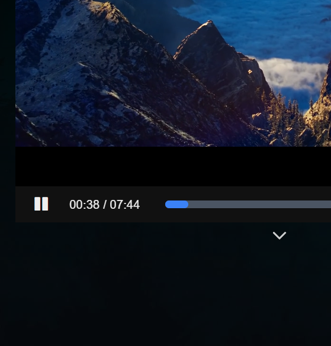 | 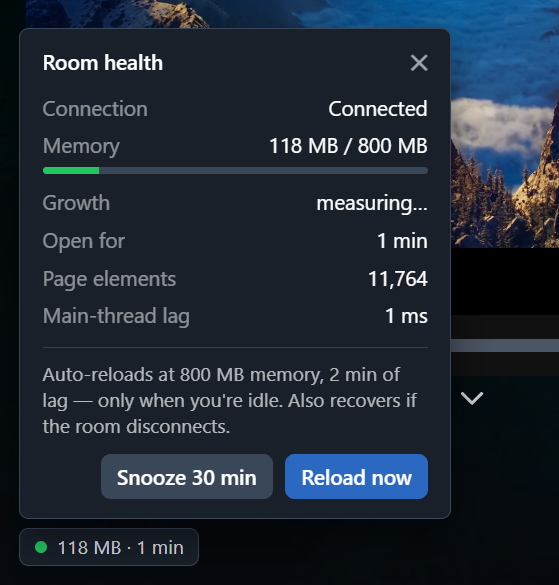 |

## Ultimate Guitar inline chords

Replaces the chord labels with inline chords.

[⬇️ Download](https://github.com/RMoura98/moura-userscripts/raw/main/ultimate-guitar-inline-chords.user.js)

| Before | After |
|--------|-------|
|  |  | 
 

## Trakt dashboard multiple rows

> ❌ **Retired.** Trakt's old dashboard (`trakt.tv/dashboard`) now redirects to the new app (`app.trakt.tv/home`), so this script no longer runs. Its hourly auto-refresh lives on in [Trakt & MAL → Sonarr / Radarr / Jellyfin](#trakt--mal--sonarr--radarr--jellyfin).

Allows to have multiple rows of tvshows on the trakt dashboard

[⬇️ Download](https://github.com/RMoura98/moura-userscripts/raw/main/trakt-dashboard-multiple-rows.user.js)

| Before | After |
|--------|-------|
|  |  |

## Telegram auto-close chat

Presses Escape to close the open chat and return to the chat list whenever the Telegram Web tab is hidden.

[⬇️ Download](https://github.com/RMoura98/moura-userscripts/raw/main/telegram-auto-close-chat.user.js)

## Allianz Care timeout redirect

When your MyHealth session expires, Allianz Care drops you on a login page with `timeOut=true`. This sends you straight back to the Allianz Care home page instead.

[⬇️ Download](https://github.com/RMoura98/moura-userscripts/raw/main/allianz-timeout-redirect.user.js)

## Claude.ai login email autofill

Prefills the email field on the Claude.ai login and signup pages. It never overwrites something you've already typed.

The email isn't stored in the script: set it once from the Tampermonkey menu → **Set login email** (leave it empty to turn the autofill off).

[⬇️ Download](https://github.com/RMoura98/moura-userscripts/raw/main/claude-login-email-autofill.user.js)

## Trakt & MAL → Sonarr / Radarr / Jellyfin

Connects Trakt show and movie pages (`app.trakt.tv`) and MyAnimeList anime pages (`myanimelist.net/anime/…`) to your own media stack. One script and one set of settings for both sites. No Trakt or MAL API key needed.

**On Trakt**

- **Action button** in Trakt's action bar, with a status dot (following / paused / error) and a dropdown styled like Trakt's own menus.
- **Sonarr / Radarr**: see episode or file status and size, follow or unfollow, monitor the current season, start a search, or add the title (with your chosen quality profile and root folder).
- **Jellyfin**: if the title (or season) is in your library, a Jellyfin tile shows up in "Where to Watch" and opens it directly.
- **Home auto-refresh**: reloads `app.trakt.tv/home` once it has been open for an hour (not while you're typing or the dropdown is open), so Up Next stays current. Change `HOME_REFRESH_MINUTES` to adjust.

**On MyAnimeList**

- A **Library** section in the sidebar, in MAL's own style: follow status, episode counts for the exact season the MAL entry covers, follow/unfollow, monitor that season, start a search, or add the series to Sonarr as an anime series (movies go to Radarr).
- MAL's **Watch Episodes** button turns into **Watch on Jellyfin** and opens the right season or movie when you have it.
- IDs come from [Fribb/anime-lists](https://github.com/Fribb/anime-lists) (cached for 7 days), then the ARM API, then a title search in Sonarr/Radarr.

Jellyfin is matched by TVDB/TMDB id first, then by exact name and year, so libraries that use other metadata (e.g. AniDB for anime) are still found.

Nothing personal is stored in the script: set the Sonarr, Radarr and Jellyfin URLs and API keys from the Tampermonkey menu (or **Settings** on either site). **↻ Refresh caches** in the menu clears the cached ID matches and Jellyfin index. Failed requests are logged to the console under `[arr-jellyfin]`, with keys masked.

[⬇️ Download](https://github.com/RMoura98/moura-userscripts/raw/main/trakt-arr-jellyfin.user.js)

**Trakt**

| Before | After |
|--------|-------|
| 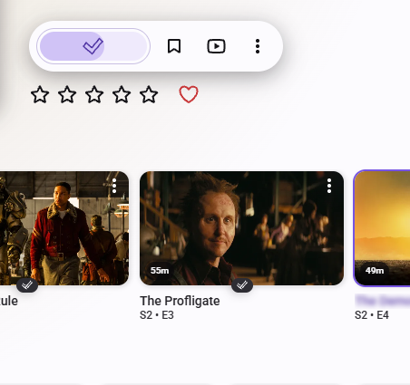 | 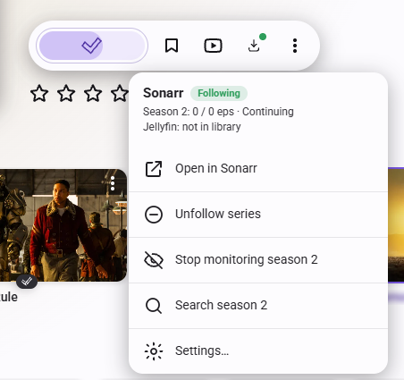 |

**MyAnimeList**

| Before | After |
|--------|-------|
| 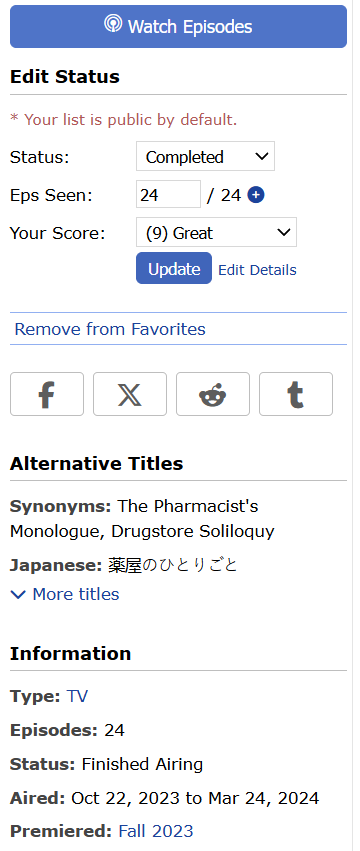 | 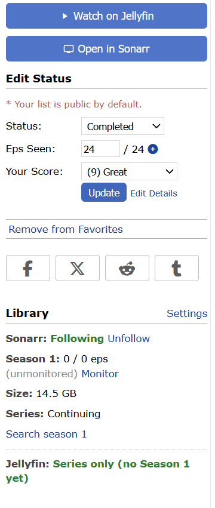 |

## MAL Seasonal Tab Opener

Adds an **Open All Tabs** link next to "View More" in the seasonal anime widget on the MyAnimeList home page. One click opens every anime in that widget in background tabs.

[⬇️ Download](https://github.com/RMoura98/moura-userscripts/raw/main/mal-seasonal-tab-opener.user.js)

| Before | After |
|--------|-------|
| 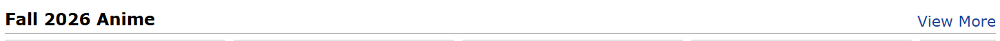 | 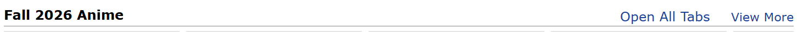 |

## Google Flights price per person

Google Flights shows the total for all passengers. When you search for more than one passenger, hover any price to see what it comes to per person (for example "€153 per person (2 passengers)") in a tooltip styled like Google's own. Works with prices shown in euros.

[⬇️ Download](https://github.com/RMoura98/moura-userscripts/raw/main/google-flights-price-per-person.user.js)

| Before | After |
|--------|-------|
| 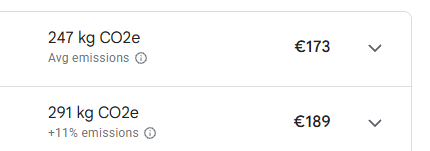 | 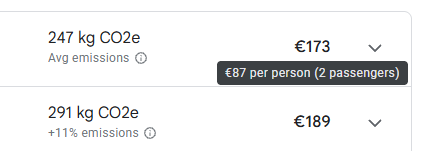 |

## Mini Profiler fade

Makes the [rack-mini-profiler](https://github.com/MiniProfiler/rack-mini-profiler) timing badge 10% opaque on local Rails apps (`http://localhost:3000`), so it stays out of the way.

[⬇️ Download](https://github.com/RMoura98/moura-userscripts/raw/main/mini-profiler-fade.user.js)

## Riverside Copy Transcript

Adds a **Copy transcript** button (next to Comments) in the [Riverside](https://riverside.com) editor and review pages. The editor draws the transcript on a canvas, so it can't be selected and copied as text; this button copies the full transcript to the clipboard instead.

- Speakers are labelled with a `[mm:ss]` timestamp, and consecutive sentences from the same speaker are joined into one paragraph.
- Copies the full recorded transcript, including any parts cut in the edit.
- Also available from the Tampermonkey menu → "Copy transcript".

[⬇️ Download](https://github.com/RMoura98/moura-userscripts/raw/main/riverside-copy-transcript.user.js)

## GitHub Stargazers button

Adds a small icon button with the people icon to the repository header, between **Star** and the star-lists dropdown, styled like GitHub's own buttons (with the native "Stargazers" tooltip). Click it to open the repo's stargazers page.

- Only appears on repositories where you can see the **Settings** tab, so it stays out of the way on other people's repos.
- Keeps working through GitHub's in-page navigation and stays visible on narrow screens.

[⬇️ Download](https://github.com/RMoura98/moura-userscripts/raw/main/github-stargazers-button.user.js)

| Before | After |
|--------|-------|
| 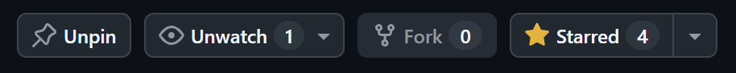 | 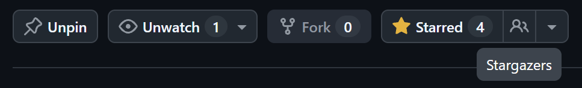 |

## GitHub Forks button

Adds a small icon button with the list icon to the repository header, joined to the right of **Fork** and styled like GitHub's own buttons (with the native "Forks" tooltip). Click it to open the repo's forks list (`/<owner>/<repo>/forks`).

- Only appears on repositories where you can see the **Settings** tab, so it stays out of the way on other people's repos.
- Keeps working through GitHub's in-page navigation.

[⬇️ Download](https://github.com/RMoura98/moura-userscripts/raw/main/github-forks-button.user.js)

| Before | After |
|--------|-------|
| 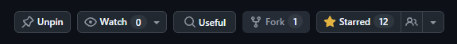 | 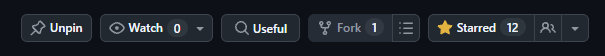 |
